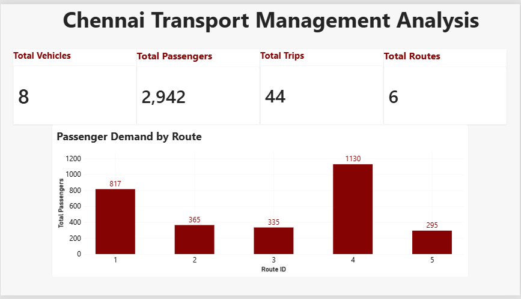
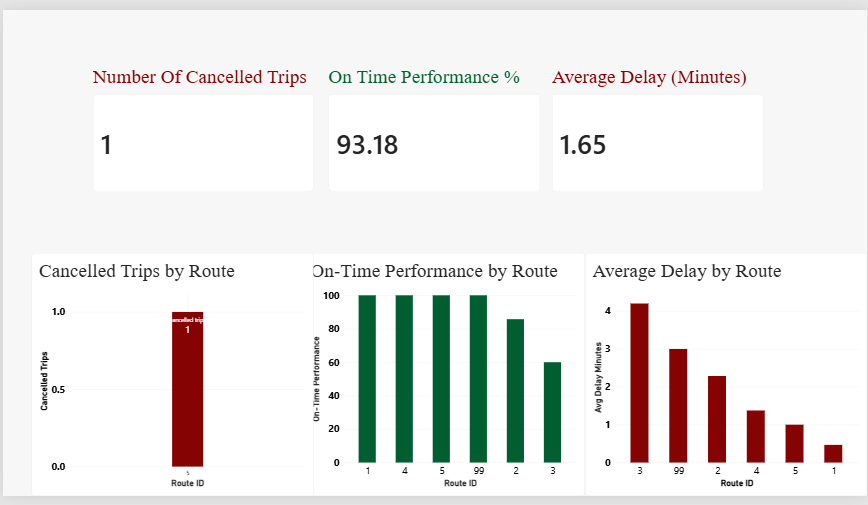
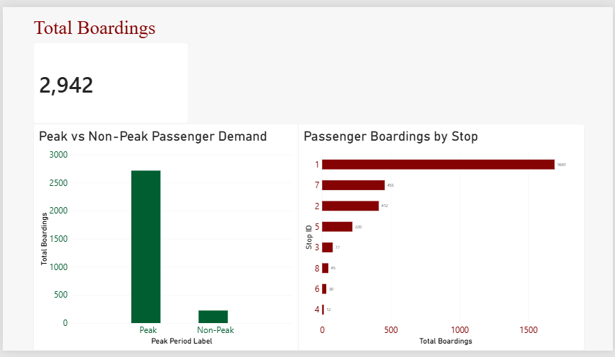
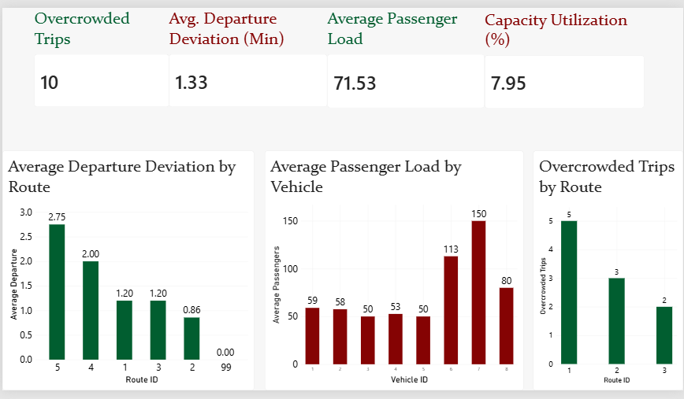

# Chennai Transport Management Analysis

## Project Overview

This project analyzes Chennai transport operations using MySQL and Power BI. It focuses on route performance, passenger demand, vehicle capacity, and operational efficiency.

## Business Problem

Public transportation systems need to manage routes, schedules, passenger demand, and vehicle capacity efficiently. Delays and overcrowding can affect operational performance and passenger experience.

This project uses transport data to identify patterns and support data-driven decision-making.

## Project Objectives

- Analyze passenger demand across routes and stops.
- Evaluate on-time performance and trip delays.
- Identify cancelled and overcrowded trips.
- Analyze passenger load across vehicles.
- Measure vehicle capacity utilization.
- Build an interactive Power BI dashboard.

## Tools & Technologies

- MySQL
- Power BI
- DAX

## Dataset

The dataset contains 10 tables related to transport operations, including trips, schedules, vehicles, passenger counts, stops, and supporting data.

Main analytical tables:
- `actual_trips`
- `trip_schedules`
- `vehicles`
- `passenger_counts`
- `stops`

## Dashboard Pages

### 1. Overview
- Total Vehicles
- Total Passengers
- Total Trips
- Total Routes
- Passenger Demand by Route

### 2. Route Performance
- On-Time Performance
- Average Delay
- Cancelled Trips by Route

### 3. Passenger Demand
- Total Boardings
- Peak vs Non-Peak Passenger Demand
- Passenger Boardings by Stop

### 4. Capacity & Operations
- Overcrowded Trips
- Average Passenger Load
- Average Departure Deviation
- Capacity Utilization
- Average Passenger Load by Vehicle
- Overcrowded Trips by Route

## SQL Analysis

SQL was used for data exploration and analysis using:
- Joins
- Aggregate functions
- GROUP BY and HAVING
- Subqueries and CTEs
- Window functions such as RANK(), ROW_NUMBER(), and LAG()

## Power BI & DAX

Power BI was used to:
- Build a data model
- Create DAX measures
- Develop KPI cards and charts
- Create a multi-page dashboard

## Conclusion

This project demonstrates how SQL and Power BI can be used to analyze transportation data and develop an interactive dashboard for operational monitoring and planning.

## Dashboard Screenshots

### Overview


### Route Performance


### Passenger Demand


### Capacity & Operations


## Project Structure

```text
Chennai-Transport-Management-Analysis/
│
├── README.md
├── chennai_transport_analysis.pbix
├── CTA Sql query.sql
├── Overview.png
├── Route-Performance.png
├── Passenger_Demand.png
└── capacity&Operations.png
